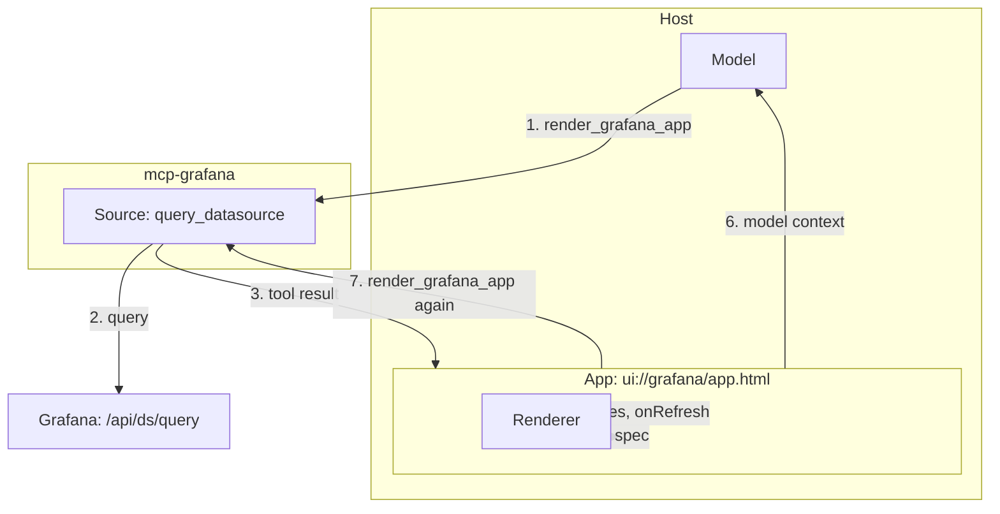

# Grafana visualization contract

A model in an MCP client asks Grafana for a chart. The `query_datasource` source of the `render_grafana_app` tool
in `grafana/mcp-grafana` runs the query. The App, an MCP Apps view, gets the result. The Renderer draws the chart.

This contract gives the shapes and the rules that pass between these parts. A part that follows the contract
works with the other parts. Its engineers do not have to ask the engineers of the other parts.

## Parts



| Interface | From | To | Files |
| --------- | ---- | -- | ----- |
| Tool arguments | Model | Source | [1-tool.md](1-tool.md), `schemas/query-datasource-args.schema.json` |
| Tool result | Source | App | [1-tool.md](1-tool.md), `schemas/tool-result.schema.json` |
| Viz spec | App | Renderer | [2-viz-spec.md](2-viz-spec.md), `schemas/viz-spec.schema.json` |
| Renderer API | App | Renderer | [3-renderer.md](3-renderer.md), `renderer-api.d.ts` |
| States, notices and model context | Renderer, App | App, Model | [4-states-and-notices.md](4-states-and-notices.md) |
| Refresh | Renderer, App | App, Source | [5-refresh.md](5-refresh.md) |

## Terms

| Term | Meaning |
| ---- | ------- |
| Host | The MCP client that shows the App, for example Claude web and Desktop, Cursor and ChatGPT |
| Source | The Go code in mcp-grafana that runs the query (`query_datasource` in `render_grafana_app`) |
| App | The view in `ui://grafana/app.html` of mcp-grafana that gets the tool result and calls the Renderer |
| Renderer | The browser bundle that draws a viz spec |
| Viz spec | The JSON object that the App gives to the Renderer |
| Icon cache | The `react-inlinesvg` cache of the copy of `@grafana/ui` in the App. `Icon` reads an SVG from it, and makes no request for that SVG |
| Note | A text line that the Source gives to `render_grafana_app`, and that the model reads in the same turn (`tool.28`). Not a notice: the Renderer shows a notice in the chart (`state.7`) |

The Renderer draws the panels of the package `@plugins/grafana-echarts`.

## How to read

1. Files 1 to 5 give the interfaces in build order. Files 6 to 8 apply to all of them.
2. Read the files of your part only:

   | Part | Files |
   | ---- | ----- |
   | Source | 1, 6, 8, the schemas of the tool arguments and the tool result, and `registry/` |
   | App | 1 to 8, and the registries of states, notices and constants |
   | Renderer | 2 to 8, `renderer-api.d.ts`, and the registries of panel types, states, notices and constants |

3. The schemas give the shapes. The prose gives the behavior only, and does not repeat a schema.
   `schemas/bundled/` holds each schema as one file with no reference to another file. Consumers use the bundled
   files.
4. Each rule has a stable ID: a file prefix, a dot and a number, for example `refresh.3`. A test names the ID of
   the rule that it checks. An ID never gets a new meaning. The ID of a removed rule is not used again.
5. "Must" is a requirement. "Can" is a permission.
6. The prose names a fixed value by its constant, for example `maxResultBytes`. The value is in
   `registry/constants.json` and in the table below.

## Use the package

The npm package `@grafana/viz-contract` holds the bundled schemas, the registries, the fixtures and the types of
the Renderer API. Each package version is a contract version.

```sh
npm install --save-dev @grafana/viz-contract
```

```ts
import panelTypes from '@grafana/viz-contract/registry/panel-types.json' with { type: 'json' };
import vizSpecSchema from '@grafana/viz-contract/schemas/viz-spec.schema.json' with { type: 'json' };
import type { RenderOptions } from '@grafana/viz-contract/renderer-api';
```

`renderer-api` has types only. Import it with `import type`. The functions that it declares come from the Renderer.

A test that reads all fixtures finds the folder like this:

```ts
import { createRequire } from 'node:module';
import path from 'node:path';

const pkg = createRequire(import.meta.url).resolve('@grafana/viz-contract/package.json');
const fixturesDir = path.join(path.dirname(pkg), 'fixtures');
```

## Use the Go module

The Go module `github.com/grafana/viz-contract` holds the bundled schemas, the registries and the fixtures. It has
the same tags as the npm package. A function gives each folder as its own `fs.FS`: `Registry()` (`registry/`),
`Schemas()` (`schemas/bundled/`) and `Fixtures()` (`fixtures/`). A binary that calls only `Registry()` does not
carry the fixtures. A path does not start with the folder name. It is the path after the folder in the npm package.

```sh
go get github.com/grafana/viz-contract@latest
```

```go
import (
	"io/fs"

	vizcontract "github.com/grafana/viz-contract"
)

chartTypes, err := fs.ReadFile(vizcontract.Registry(), "chart-types.json")
vizSpec, err := fs.ReadFile(vizcontract.Schemas(), "viz-spec.schema.json")
args, err := fs.ReadFile(vizcontract.Fixtures(), "prometheus-line/args.json")
```

## Promises

The interfaces do not have the same promise of stability. [8-versioning.md](8-versioning.md) gives the three
promises and the promise of each interface.

The tool result, the viz spec and the Renderer API have the internal promise. They can change in any minor
version, with no deprecation period. If you build on them outside mcp-grafana and the Renderer, pin a tagged
version.

## Constants

<!-- constants:start. A script makes this table from registry/constants.json. Do not edit it. -->
| Name | Value | Unit | Changeable | Meaning |
| ---- | ----- | ---- | ---------- | ------- |
| `maxResultBytes` | 1048576 | bytes | yes | Largest structuredContent of the tool result |
| `refreshTimeoutMs` | 60000 | ms | no | Time before a refresh with no result fails |
| `defaultHeightPx` | 400 | px | no | Chart height when the element height is 0 |
| `defaultFrom` | now-1h | time | no | from when the tool arguments have none |
| `defaultTo` | now | time | no | to when the tool arguments have none |
| `defaultMaxDataPoints` | 1000 | points | no | maxDataPoints of a query that has none. intervalMs is the range divided by it |
| `maxSeries` | 50 | series | yes | Most series that the Renderer draws |
| `maxBundleGzipBytes` | not set | bytes | yes | Largest gzip size of the Renderer bundle. Not set until the host size research is done |
| `maxAppNotes` | 5 | notes | yes | Most notes of the Source that render_grafana_app adds to its text line |
| `maxAppNoteChars` | 200 | characters | yes | Longest note in the text line of render_grafana_app |
| `maxTitleChars` | 100 | characters | yes | Longest title of the tool arguments |
| `maxMessageChars` | 1000 | characters | yes | Longest text of a message that the App sends to the conversation |
| `maxMessageLabels` | 10 | labels | yes | Most labels of the series in a message |
| `maxMessageValueChars` | 100 | characters | yes | Longest value or label key in a message, for example a series name or a label value |
| `deprecationDays` | 30 | days | yes | Shortest deprecation period of a change to a frozen interface |
| `specVersion` | 1 | version | no | The viz spec version that this contract gives |
<!-- constants:end -->

## Not in this contract

1. Behavior inside one part. For example, zoom, pan and the Reset button are Renderer UI.
2. Size changes and display modes between the App and the Host. The
   [MCP Apps specification](https://github.com/modelcontextprotocol/ext-apps) gives them.
3. Items that are not specified yet. [future.md](future.md) lists them in priority order.

## Changes

The [GitHub Releases](https://github.com/grafana/viz-contract/releases) list the versions. [CHANGELOG.md](CHANGELOG.md)
lists the versions before 1.2.0. [CONTRIBUTING.md](CONTRIBUTING.md) gives the steps to change the contract.
